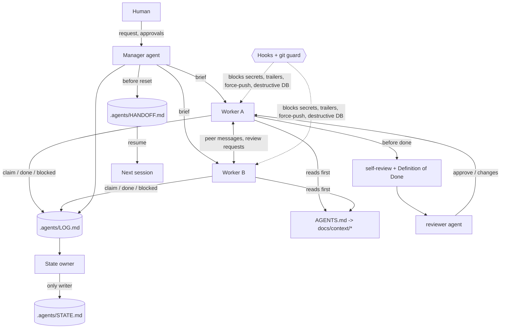

# Agent Workflow Kit

A team workflow for coding agents, packaged as a **Claude Code plugin** and as **plain templates that work with any agent**: Claude Code, Codex, Cursor, Gemini CLI, GitHub Copilot, or anything else that reads `AGENTS.md`.

It gives a repo:

- **Short project memory.** A small `AGENTS.md` index plus one-topic docs that agents open only when needed.
- **Team rules in the repo, not in someone's personal memory.** Never-break rules, git and approval rules, code comments, Definition of Done with evidence.
- **Safe ways to work.** Safe-change and self-review checklists, peer review, bug intake, TDD, debugging.
- **Several agents at once.** A manager and workers, one state owner, file claims, and agent-to-agent messages (through the manager or directly). It works in one shared checkout or in separate git worktrees.
- **Continuity.** Hand-off and resume across context resets and machines, plus a token budget and auto-compact setup.
- **Guards.** Hooks that block AI commit trailers, secrets, force-pushes and destructive database commands, and ask before protected-file edits and pushes to protected branches. A tool-neutral git-hook version protects every agent.
- **Practical skills.** Frontend design, responsive UI, HTML pages, design review, web-app testing, mobile apps, API design, DB migrations, security audit, AWS and GCP ops, time zones, file uploads, AI features, skill testing, and caveman (terse) mode.

Everything is plain Markdown and dependency-free Node.js.

---

## Install

### Claude Code (plugin)

```bash
claude plugin marketplace add BeastabTech/agent-workflow-kit
claude plugin install agent-workflow-kit@agent-workflow-kit
```

Then, inside a repo, ask: **"set up the agent workflow here"**. The `init` skill interviews you and writes the files. Skills are namespaced, for example `/agent-workflow-kit:bug-intake`.

### Any other agent (no plugin)

```bash
git clone https://github.com/BeastabTech/agent-workflow-kit
cp agent-workflow-kit/templates/answers.example.json answers.json   # edit it
node agent-workflow-kit/scripts/init-project.js --target ./my-repo --answers answers.json --with-git-hooks
node agent-workflow-kit/scripts/export-skills.js --target ./my-repo --to agents
```

Then turn on the git hooks in that repo (this changes its git config, so it is your call):

```bash
git -C my-repo config core.hooksPath .githooks
```

Add `--dry-run` to see what would be written. Existing files are never overwritten unless you pass `--force`.

---

## How it fits together



More: [docs/FLOW.md](docs/FLOW.md).

---

## What `init` writes into a project

| Path | What |
|---|---|
| `AGENTS.md` | The index every agent reads first: golden rules, work mode, navigation table, token-saving rules, compact instructions |
| `CLAUDE.md`, `GEMINI.md` | One line that imports `AGENTS.md` |
| `.cursor/rules/agent-workflow.mdc`, `.github/copilot-instructions.md` | Pointers to `AGENTS.md` for Cursor and Copilot (Codex reads `AGENTS.md` natively) |
| `.codex/agents/*.toml` | Read-only explorer and reviewer agents for Codex |
| `.claude/rules/*.md` | Team rules: never-break, working agreement, git and approvals, code comments. Plain Markdown, for every tool |
| `.claude/settings.json` | Earlier auto-compact (`CLAUDE_AUTOCOMPACT_PCT_OVERRIDE=75`) |
| `docs/context/*` | Architecture, module map with owners, conventions, testing, self-review, Definition of Done, agent communication, debugging, feature docs |
| `.agents/config.json` | Team settings the hooks read: work mode, protected branches and files, state sync |
| `.agents/STATE.md`, `HANDOFF.md`, `BUGS.md` | Shared state (one owner), hand-off note, bug list |
| `.agents/tools/msg.js` | Message log CLI for agent-to-agent messages and file claims (any tool can run it) |
| `.githooks/*`, `.agents/tools/git-guard.js` | Optional tool-neutral pre-commit and commit-msg checks |
| `.agents/skills/*` | Optional: the skills exported for non-Claude agents |

---

## Skills

| Area | Skills |
|---|---|
| Setup and memory | `init`, `docs-sync`, `context-budget`, `caveman` |
| Several agents | `manager`, `state-keeper`, `agent-comms`, `handoff`, `peer-review`, `team-message` |
| Everyday engineering | `plan`, `tdd`, `debug`, `bug-intake`, `safe-change`, `self-review`, `git-workflow` |
| Backend and data | `api-design`, `db-migration`, `file-uploads`, `timezones-i18n`, `ai-feature`, `security-audit` |
| Frontend and apps | `frontend-design`, `responsive-ui`, `html-page`, `design-review`, `webapp-testing`, `mobile-app` |
| Cloud and release | `aws-ops`, `gcp-ops`, `deploy` (manual only: `/agent-workflow-kit:deploy`) |
| Plugin authors | `skill-testing` |

## Agents

| Agent | Use |
|---|---|
| `reviewer` | Strict read-only review of a diff against the project's rules and Definition of Done |
| `explorer` | Read-only "where is X / what depends on Y" mapper on a cheap model |
| `security-reviewer` | Read-only security review with attack paths |
| `qa-tester` | Tests a feature like a user and files bugs in `.agents/BUGS.md` |

## Hooks

| Check | When | Result |
|---|---|---|
| `ai-trailers` | `git commit` with Co-Authored-By, "Generated with" or a robot emoji line | block |
| `secret-scan` | `git commit` with a clear credential or an env file; Write/Edit with a clear credential | block (ask for weaker matches) |
| `explicit-staging` | `git add -A` / `.` / `commit -a` | block in shared mode, warn in worktree mode |
| `force-push` | force push or `+ref` push | block (with lease: ask) |
| `protected-branch` | push to or commit on a protected branch | ask |
| `destructive-db` | `migrate reset`, `db push`, `DROP`, `TRUNCATE`, `DELETE` without `WHERE`, `FLUSHALL`, `terraform destroy`, and similar | block (configurable to ask) |
| `protected-files`, `env-files` | edit of a protected glob or an env file | ask |
| Session start | `.agents/` exists, or right after compaction | short note: work mode, hand-off, unread messages |

Off switches: `AWK_HOOKS=off`, `AWK_DISABLE=<check>,<check>`, plugin options, or `.agents/config.json`. Details: [docs/HOOKS.md](docs/HOOKS.md).

---

## Modes

- **Work mode.** `shared`: one checkout; claim files first and stage explicit paths. `worktree`: each writing agent gets its own git worktree and branch. The message log always lives in the main checkout, so every worktree sees the same messages.
- **Talking.** `hub`: workers talk through the manager. `peer`: workers message each other directly and copy the manager on decisions. Agents use the tool's own messaging when it has it, or the file log `.agents/LOG.md` when it doesn't (or across tools and machines).
- **State sync.** `git` (committed), `folder` (a synced folder), or `local` (one machine).

Details: [docs/MODES.md](docs/MODES.md) and [docs/COMMUNICATION.md](docs/COMMUNICATION.md).

## Works with

| Tool | Reads |
|---|---|
| Claude Code | Plugin skills, agents and hooks, `CLAUDE.md` → `AGENTS.md`, `.claude/rules/` |
| Codex | `AGENTS.md`, `.codex/agents/*.toml`, exported skills |
| Cursor | `AGENTS.md`, `.cursor/rules/agent-workflow.mdc`, exported skills |
| Gemini CLI | `GEMINI.md` → `AGENTS.md`, exported skills |
| GitHub Copilot | `AGENTS.md`, `.github/copilot-instructions.md` |
| Anything else | `AGENTS.md` and the git hooks |

Skills use the open `SKILL.md` format. `export-skills.js --to agents,codex,cursor,gemini,claude` copies them to the folder each tool scans. Folder names differ between tools and versions, so check your tool's docs. See [docs/COMPATIBILITY.md](docs/COMPATIBILITY.md).

## Configuration

Personal plugin options are set when you enable the plugin: `hooks_enabled`, `block_ai_trailers`, `secret_scan`, `destructive_db_guard`, and `reply_style` (`normal`, `caveman-lite`, `caveman-full`). Team settings live in `.agents/config.json`. Reference: [docs/CONFIG.md](docs/CONFIG.md).

## Worked example

[examples/README.md](examples/README.md) follows a small to-do API from setup through a bug report, intake, regression test, fix, review, state update and hand-off.

## Develop and test

```bash
node --test tests/*.test.js                       # hook, init, export, git-guard and message-log tests
claude plugin validate . --strict                 # manifest checks
claude plugin eval . --runs 1 --case 'bug-intake*'  # behaviour evals (uses model tokens)
claude --plugin-dir .                             # try it locally
```

See [CONTRIBUTING.md](CONTRIBUTING.md). Security reports: [SECURITY.md](SECURITY.md).

## Credits

The caveman skill is an independent rewrite inspired by Julius Brussee's MIT-licensed caveman skill. Several workflow ideas were inspired by the open-source Everything Claude Code collection. See [NOTICE](NOTICE).

## License

MIT. See [LICENSE](LICENSE).
