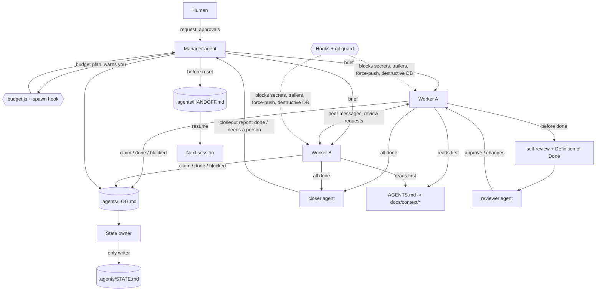

# Agent Workflow Kit

A team workflow for coding agents, packaged as a **Claude Code plugin** and as **plain templates that work with any agent**: Claude Code, Codex, Cursor, Gemini CLI, GitHub Copilot, or anything else that reads `AGENTS.md`.

It gives a repo:

- **Short project memory.** A small `AGENTS.md` index plus one-topic docs that agents open only when needed.
- **Team rules in the repo, not in someone's personal memory.** Never-break rules, git and approval rules, code comments, Definition of Done with evidence.
- **Safe ways to work.** Safe-change and self-review checklists, peer review, bug intake, TDD, debugging.
- **Several agents at once.** A manager and workers, one state owner, file claims, and agent-to-agent messages (through the manager or directly). It works in one shared checkout or in separate git worktrees. You talk to the manager; it relays instructions to any worker, shows who is doing what, and you can still open a worker's session yourself.
- **A spawn budget.** Limits on sub-agents running at once and per session, a plan check before anything starts, and a warning (or a question to you) before a limit is crossed.
- **A closer.** After the workers finish, one agent checks the whole feature, fixes clear small gaps, asks you only for real decisions and reports to the manager.
- **Continuity.** Hand-off and resume across context resets and machines, plus a token budget and auto-compact setup.
- **Guards.** Hooks that block AI commit trailers, secrets, force-pushes and destructive database commands, and ask before protected-file edits and pushes to protected branches. A tool-neutral git-hook version protects every agent.
- **Practical skills.** Frontend design, responsive UI, HTML pages, design review, web-app testing, mobile apps, API design, DB migrations, security audit, AWS and GCP ops, time zones, file uploads, AI features, skill testing, and caveman (terse) mode.

Everything is plain Markdown and dependency-free Node.js.

## What it does, and what it does not

**It is** a safety net, shared project memory and a hand-off routine for coding agents: hooks that block secrets, force-pushes and destructive database commands; short rules and docs every tool reads; manager, review and hand-off workflows for several agents.

**It is not** a way to get better code or fewer tokens out of a single task. We measured that and it does not show up:

| Sonnet, hidden-test scoring, 3 runs per task | Tasks passed completely | Tokens per run vs no kit |
|---|---|---|
| Large monolith (6 tasks): no kit | 67% | 69k |
| lite / low-tokens | 67% / 72% | -2% / -3% |
| auto / normal / best | 61% / 72% / 67% | +1% / +2% / +6% |
| Small module (3 tasks): no kit | 33% | 24k |
| lite / low-tokens | 33% / 33% | +9% / +4% |
| auto / normal / best | 33% / 33% / 33% | +34% / +37% / +46% |

Results were within noise of using no kit. (The small-module figures for `auto`, `normal` and `best` come from the first run, which still had the done gate; with the gate limited to `best`, `normal` and `auto` were still 12 to 65 percent above no kit per task.) The full editions add a fixed context cost (about 6k tokens per session), which matters on small tasks and is small on large ones. Pick `lite` or `low-tokens` if you only want the safety net. Tokens, not money, because prices change. Method, per-task tables and limits: [docs/BENCHMARK.md](docs/BENCHMARK.md) and [docs/benchmarks/real-tasks.md](docs/benchmarks/real-tasks.md).

---

## Quick start

**Claude Code.** Run these two commands inside Claude Code:

```text
/plugin marketplace add BeastabTech/agent-workflow-kit
/plugin install agent-workflow-kit@agent-workflow-kit
```

Then, in your repo, say **"set up the agent workflow here"**. That's it. Skills are namespaced, for example `/agent-workflow-kit:bug-intake`.

**Codex, Cursor, Gemini CLI, Copilot or anything else.** Run these from your repo's root folder:

```bash
git clone https://github.com/BeastabTech/agent-workflow-kit ../agent-workflow-kit
node ../agent-workflow-kit/scripts/init-project.js --target . --tools codex,cursor,gemini,copilot --with-git-hooks
node ../agent-workflow-kit/scripts/export-skills.js --target . --to agents
```

Optional: `git config core.hooksPath .githooks` turns on the git guard for every tool.

Existing files are never overwritten unless you pass `--force`, and `--dry-run` previews the changes. Update, remove, and the terminal (`claude plugin ...`) version are in [docs/INSTALL.md](docs/INSTALL.md).

---

## Pick an edition

The install asks which one you want. Pick by the work, not the biggest one. Details: [docs/EDITIONS.md](docs/EDITIONS.md).

| Edition | For | What changes |
|---|---|---|
| `lite` | quick fixes, small projects | safety net only, compact `AGENTS.md`, 5 skills, no plugin needed |
| `low-tokens` | cutting cost | short replies, solo unless the problem is big, 9 skills, no plugin needed |
| `auto` | let the kit decide | sizes each task from your words and the repo, then acts like low-tokens, normal or best |
| `normal` (default) | most work | all skills and hooks, sub-agents only where they pay off |
| `best` | work you want reviewed hard | strict hooks, a test run and a test file required before done, independent review of risky code, closeout |

Repeating work (fix until green, review and fix, watch) goes through the `loop` skill, which has a round limit and a stuck rule. Every edition sizes the problem first (`budget.js triage --task "..."`; `auto` does it itself): small work is solo on a small model, bigger work earns more agents and a stronger model, risky code always gets a reviewer. Terminal: `node scripts/init-project.js --target . --preset best` (asks if you leave `--preset` out).

## How it fits together



More: [docs/FLOW.md](docs/FLOW.md).

---

## What `init` writes into a project

| Path | What |
|---|---|
| `AGENTS.md` | The index every agent reads first: golden rules, work mode, navigation table, token-saving rules, compact instructions |
| `CLAUDE.md`, `GEMINI.md` | One line that imports `AGENTS.md` |
| `.cursor/rules/agent-workflow.mdc`, `.github/copilot-instructions.md` | Pointers to `AGENTS.md` for Cursor and Copilot (Codex reads `AGENTS.md` natively) |
| `.codex/agents/*.toml` | Read-only explorer and reviewer agents for Codex |
| `.claude/rules/*.md` | Team rules: never-break, working agreement, git and approvals, code comments. Plain Markdown, for every tool |
| `.claude/settings.json` | Earlier auto-compact (`CLAUDE_AUTOCOMPACT_PCT_OVERRIDE=75`) |
| `docs/context/*` | Architecture, module map with owners, conventions, testing, self-review, Definition of Done, agent communication, debugging, feature docs |
| `.agents/config.json` | Team settings the hooks read: work mode, protected branches and files, state sync |
| `.agents/STATE.md`, `HANDOFF.md`, `BUGS.md` | Shared state (one owner), hand-off note, bug list |
| `.agents/tools/msg.js` | Message log CLI for agent-to-agent messages and file claims (any tool can run it) |
| `.githooks/*`, `.agents/tools/git-guard.js` | Optional tool-neutral pre-commit and commit-msg checks |
| `.agents/skills/*` | Optional: the skills exported for non-Claude agents |

---

## Skills

| Area | Skills |
|---|---|
| Setup and memory | `init`, `docs-sync`, `context-budget`, `lessons`, `caveman` |
| Several agents | `manager`, `state-keeper`, `agent-comms`, `handoff`, `peer-review`, `team-message`, `team-status` |
| Everyday engineering | `plan`, `tdd`, `debug`, `bug-intake`, `safe-change`, `self-review`, `closeout`, `git-workflow` |
| Low-context delegation and loops | `delegate`, `loop` |
| Backend and data | `api-design`, `db-migration`, `file-uploads`, `timezones-i18n`, `ai-feature`, `security-audit` |
| Frontend and apps | `frontend-design`, `responsive-ui`, `html-page`, `design-review`, `webapp-testing`, `mobile-app` |
| Cloud and release | `aws-ops`, `gcp-ops`, `deploy` (manual only: `/agent-workflow-kit:deploy`) |
| Plugin authors | `skill-testing` |

## Agents

| Agent | Use |
|---|---|
| `planner` | Read-only: splits a goal into tasks with file owners, order and an agent-count estimate checked against the limits |
| `reviewer` | Strict read-only review of a diff against the project's rules and Definition of Done |
| `explorer` | Read-only "where is X / what depends on Y" mapper on a cheap model |
| `security-reviewer` | Read-only security review with attack paths |
| `qa-tester` | Tests a feature like a user and files bugs in `.agents/BUGS.md` |
| `test-writer` | Writes the failing test first, edge cases and old-flow smoke tests (test files only) |
| `build-fixer` | Fixes red type-check, build and lint with the smallest change, never by weakening a test |
| `doc-updater` | Brings feature docs, module map and env examples in line with a finished change (docs only) |
| `closer` | Runs last: splits the feature into parts, finds what is missing or broken, fixes clear small gaps, asks the human only for real decisions, re-tests, and sends the manager a Closeout report |

## Hooks

| Check | When | Result |
|---|---|---|
| `ai-trailers` | `git commit` with Co-Authored-By, "Generated with" or a robot emoji line | block |
| `secret-scan` | `git commit` with a clear credential or an env file; Write/Edit with a clear credential | block (ask for weaker matches) |
| `explicit-staging` | `git add -A` / `.` / `commit -a` | block in shared mode, warn in worktree mode |
| `force-push` | force push or `+ref` push | block (with lease: ask) |
| `protected-branch` | push to or commit on a protected branch | ask |
| `destructive-db` | `migrate reset`, `db push`, `DROP`, `TRUNCATE`, `DELETE` without `WHERE`, `FLUSHALL`, `terraform destroy`, and similar | block (configurable to ask) |
| `protected-files`, `env-files` | edit of a protected glob or an env file | ask |
| `agent-budget` | Starting a sub-agent (`Agent` tool) | warn near a limit, ask when it would be crossed (parallel, per session, estimated tokens, huge or repeated briefs) |
| Session start | `.agents/` exists, or right after compaction | short note: work mode, hand-off, unread messages |

Off switches: `AWK_HOOKS=off`, `AWK_DISABLE=<check>,<check>`, plugin options, or `.agents/config.json`. Details: [docs/HOOKS.md](docs/HOOKS.md).

---

## Modes

- **Work mode.** `shared`: one checkout; claim files first and stage explicit paths. `worktree`: each writing agent gets its own git worktree and branch. The message log always lives in the main checkout, so every worktree sees the same messages.
- **Talking.** `hub`: workers talk through the manager. `peer`: workers message each other directly and copy the manager on decisions. Agents use the tool's own messaging when it has it, or the file log `.agents/LOG.md` when it doesn't (or across tools and machines).
- **State sync.** `git` (committed), `folder` (a synced folder), or `local` (one machine).

Details: [docs/MODES.md](docs/MODES.md) and [docs/COMMUNICATION.md](docs/COMMUNICATION.md).

## Works with

| Tool | Reads |
|---|---|
| Claude Code | Plugin skills, agents and hooks, `CLAUDE.md` → `AGENTS.md`, `.claude/rules/` |
| Codex | `AGENTS.md`, `.codex/agents/*.toml`, exported skills |
| Cursor | `AGENTS.md`, `.cursor/rules/agent-workflow.mdc`, exported skills |
| Gemini CLI | `GEMINI.md` → `AGENTS.md`, exported skills |
| GitHub Copilot | `AGENTS.md`, `.github/copilot-instructions.md` |
| Anything else | `AGENTS.md` and the git hooks |

Skills use the open `SKILL.md` format. `export-skills.js --to agents,codex,cursor,gemini,claude` copies them to the folder each tool scans. Folder names differ between tools and versions, so check your tool's docs. See [docs/COMPATIBILITY.md](docs/COMPATIBILITY.md).

## Configuration

Personal plugin options are set when you enable the plugin: `hooks_enabled`, `block_ai_trailers`, `secret_scan`, `destructive_db_guard`, and `reply_style` (`normal`, `caveman-lite`, `caveman-full`). Team settings live in `.agents/config.json`. Reference: [docs/CONFIG.md](docs/CONFIG.md).

## Benchmarks

How to measure the kit on your own work, and every result so far (including the ones that show no gain): [docs/BENCHMARK.md](docs/BENCHMARK.md).

---

## Works on

macOS, Linux and Windows. Everything is plain Node.js 18 or newer with no dependencies, and CI runs the tests on all three systems on Node 18 and 22. Notes for Windows: install Git for Windows (Claude Code uses its Bash for commands), the checkout is forced to LF line endings by `.gitattributes`, and the scripts accept both `C:\path` and Git Bash `/c/path` forms. Skill snippets use `git grep` instead of `grep` so they work without extra tools.

---

## Worked example

[examples/README.md](examples/README.md) follows a small to-do API from setup through a bug report, intake, regression test, fix, review, state update and hand-off.

## Develop and test

```bash
npm test                                          # same as: node tests/run.js (works in bash, PowerShell and cmd)
claude plugin validate . --strict                 # manifest checks
claude plugin eval . --runs 1 --judge-model sonnet   # behaviour evals (uses model tokens)
claude --plugin-dir .                             # try it locally
```

Contributions are welcome: new skills and agents, hook checks, adapters for more tools, benchmark results. See [CONTRIBUTING.md](CONTRIBUTING.md) and the [code of conduct](CODE_OF_CONDUCT.md). Security reports: [SECURITY.md](SECURITY.md).

## Credits

The caveman skill is an independent rewrite inspired by Julius Brussee's MIT-licensed caveman skill. Several workflow ideas were inspired by the open-source Everything Claude Code collection. See [NOTICE](NOTICE).

## License

MIT. See [LICENSE](LICENSE).
